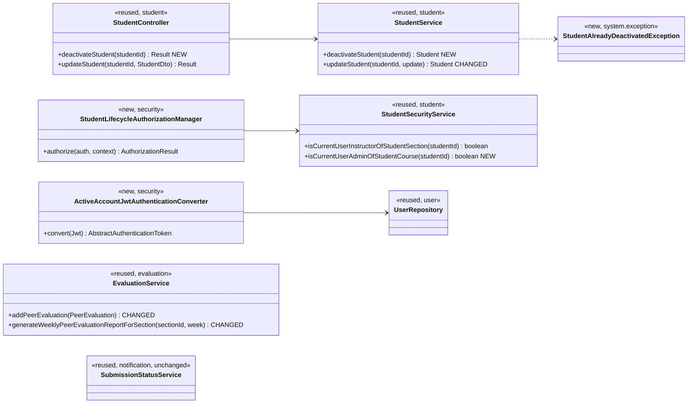
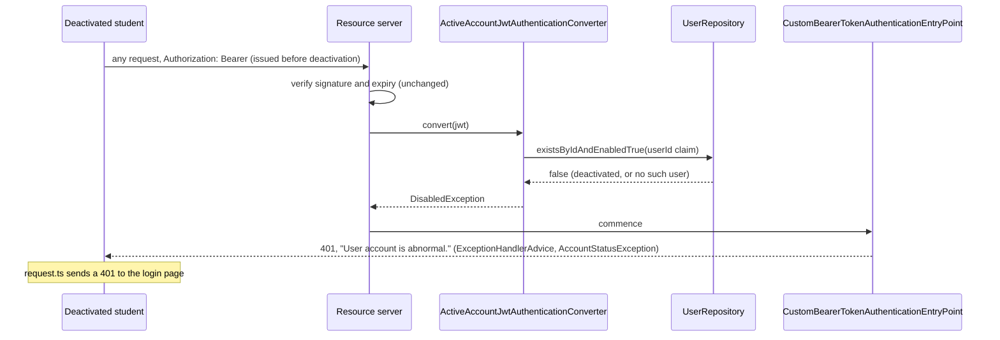
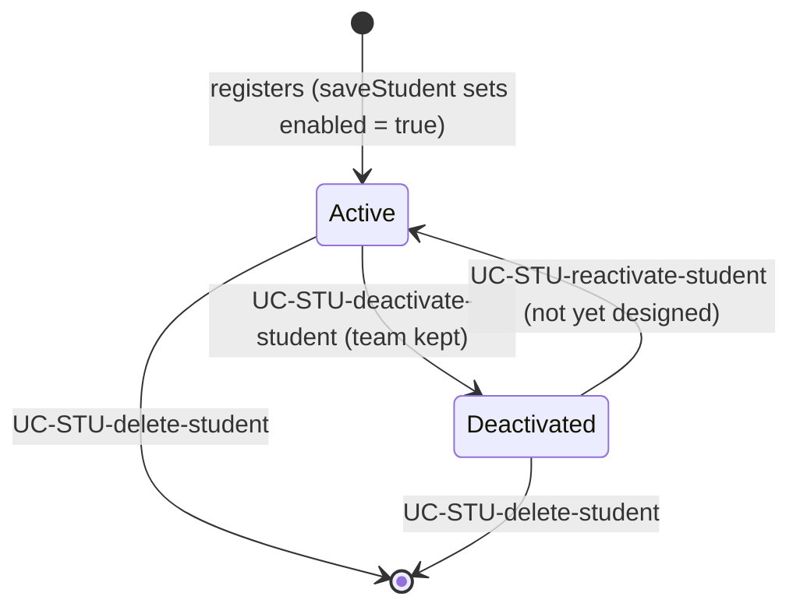

# Student (STU) Design

> Realizes: UC-STU-deactivate-student
> Depends on: FR-SEC-active-account, BR-student-lifecycle, BR-deactivated-student-evaluations, BR-submission-owed, BR-team-assignment-required, BR-role-based-access, BR-section-scoped-access
> See: [use cases](../requirements/use-cases.md#student), [business rules](../requirements/business-rules.md#course-administration), [SRS security requirements](../requirements/software-requirements-specification.md#security-and-authorization-requirements), [architectural-design.md](architectural-design.md#shared-foundation-components) (shared-foundation component view, [Authorization](architectural-design.md#authorization))
> Designed against `main` at `59f0267` (2026-11-06).

## Overview

The `student` slice in the REST API container owns a student's account: find, view, edit, delete, and, from this design on, deactivate. A student's status is the `enabled` flag that `Student` inherits from `PeerEvaluationUser`. Before this design the only way to change it was a status switch on the student edit form, saved through the generic `PUT /students/{studentId}`. That path had no consequences warning or confirmation, and it refused a course admin who is not assigned to the student's course section. Deactivation also blocked only the student's next login: a JWT issued before it stayed valid for up to two hours.

This design adds a dedicated deactivate endpoint and confirmation, and takes `enabled` out of the generic edit. It re-checks the account's status on every authenticated request, and makes peer evaluation and its weekly report respect a deactivated student. Reactivation (UC-STU-reactivate-student) is not designed yet. Until it is, no user-interface path reactivates a student.

## Components & classes



**Backend:**
- **`student/StudentController.java`:**
  - **new** `deactivateStudent`.
- **`student/StudentService.java`:**
  - **new** `deactivateStudent`, which sets `enabled = false` and never touches `team`.
  - **changed** `updateStudent`, which no longer sets `enabled`. Its `ROLE_instructor` branch goes; setting `enabled` is the branch's only effect, so the username, name, and email edits above it are untouched.
- **`student/converter/StudentDtoToStudentConverter.java`:**
  - **changed**: stops copying `enabled`. `StudentToStudentDtoConverter` still sends it out on every student response, including `GET /students/teams/{teamId}`, which is how `SubmitTeamsEvaluations.vue` sees it.
- **`student/StudentSecurityService.java`:**
  - **new** `isCurrentUserAdminOfStudentCourse`: the caller is the course admin of the course that the student's course section belongs to. Like its siblings, it returns `false` for an unknown id and never throws. `Student.section` is mandatory, so no null check is needed on it.
- **`security/authorizationmanagers/StudentLifecycleAuthorizationManager.java`:**
  - **new**: allows the instructor of the student's course section OR the course admin of its course (BR-student-lifecycle).
  - Reads `studentId` with `PathVariables.readId`.
  - UC-STU-reactivate-student will reuse it.
- **`security/ActiveAccountJwtAuthenticationConverter.java`:**
  - **new**: wraps the existing `JwtAuthenticationConverter` (the authorities claim, no prefix).
  - Asks `UserRepository.existsByIdAndEnabledTrue(userId claim)`: a primary-key check that loads no entity, because `findById` on a student would also fetch her course section and team on every request.
  - Throws `DisabledException` when the user is missing or not enabled, and also when the `userId` claim is absent or not a number (fail closed: `401`).
  - `SecurityConfiguration` registers it as the resource server's JWT converter. See *Key decisions*.
- **`security/SecurityConfiguration.java`:**
  - route rule `PATCH /students/{studentId}/deactivate` → `.access(studentLifecycleAuthorizationManager)`, placed with the other `/students/**` rules, before the `denyAll()` catch-all.
  - **changed** route rule `GET /students/{studentId}` → `AuthorizationManagers.anyOf(userOwnershipAuthorizationManager, studentLifecycleAuthorizationManager)`, so the course admin of the student's course can open her (step 2) even when not assigned to her course section (BR-section-scoped-access). `PUT` and `DELETE` on that route are unchanged.
  - the converter registration above.
- **`system/exception/StudentAlreadyDeactivatedException.java`:**
  - **new**, mapped in `ExceptionHandlerAdvice` to `409` `CONFLICT` with its message.
- **`evaluation/EvaluationService.java`:**
  - **changed** `addPeerEvaluation` and `updatePeerEvaluation`: both reject a deactivated evaluatee with `PeerEvaluationIllegalArgumentException`, whatever week the evaluation is for (BR-deactivated-student-evaluations). `updatePeerEvaluation` checks the stored evaluation's evaluatee, not the payload.
  - **changed** `generateWeeklyPeerEvaluationReportForSection`: keeps a teamed student who is active, or a deactivated one who received peer evaluations for the week, i.e. `findByWeekAndEvaluateeId` is not empty (BR-deactivated-student-evaluations). Evaluations she wrote do not count.
- **`notification/SubmissionStatusService.java`:**
  - **unchanged**: it already excludes a deactivated student and her teammates' obligation to evaluate her (BR-submission-owed). The WAR and peer evaluation report pages take their "has not submitted" lists from it ([not.md](not.md)), so neither restates the rule and neither needs a change.

**Frontend:**
- **`apis/student/index.ts`:**
  - **new** `deactivateStudent(id)`, on the shared `request` instance.
- **`pages/students/EditStudentForm.vue`:**
  - **changed**: the status switch becomes a read-only status tag, plus a **Deactivate** button shown only while the student is active.
  - The button opens `ElMessageBox.confirm(…, 'Warning', { type: 'warning' })`, the pattern in `pages/activities/MyActivities.vue` (`deleteExistingActivity`) and `pages/sections/Sections.vue` (`removeInstructor`). The message names the student and states the consequences listed in the use case's Associated Information.
  - The generic update stops sending `enabled`.
  - The button depends only on the student being active, because only instructors and course admins can open this form. The server's `403` remains the guard.
  - Errors are left to the shared `request.ts` interceptor, which already toasts the server's message for any error, sends a `403` to the Forbidden page, and a `401` to login. The page adds no toast of its own, so nothing is shown twice. After a `200` or a `409`, the form reloads the student with `findStudentById`, so the tag and button show the current status.
- **`pages/evaluations/SubmitTeamsEvaluations.vue`:**
  - **changed**: leaves out teammates whose `enabled` is false when it builds a new set of evaluations.

There is no new confirmation component. The existing `ElMessageBox.confirm` pattern for destructive actions covers step 4.

## Sequence

### UC-STU-deactivate-student: main success scenario

```mermaid
sequenceDiagram
    actor A as Course admin / instructor
    participant F as EditStudentForm.vue
    participant API as apis/student
    participant SEC as SecurityConfiguration
    participant C as StudentController
    participant S as StudentService
    participant R as StudentRepository
    A->>F: open the student (steps 1-2, UC-STU-view-student)
    A->>F: Deactivate (step 3)
    F-->>A: ElMessageBox.confirm: consequences and warning (step 4)
    alt cancel (5a)
        A->>F: Cancel
        F-->>A: nothing sent, student unchanged (5a1)
    else confirm (step 5)
        A->>F: Confirm
        F->>API: deactivateStudent(id)
        API->>SEC: PATCH /students/{id}/deactivate
        SEC->>SEC: StudentLifecycleAuthorizationManager
        alt unknown id (6b) or not permitted (6c)
            SEC-->>F: 403, "No permission."
            F-->>A: request.ts toasts the message and opens the Forbidden page (6b1, 6c1)
        else permitted
            SEC->>C: deactivateStudent(id)
            C->>S: deactivateStudent(id)
            S->>R: findById(id)
            alt already deactivated (6a)
                S-->>C: StudentAlreadyDeactivatedException
                C-->>F: 409
                F-->>A: request.ts toasts "This student is already deactivated."; the form reloads the student (6a1)
            else active
                S->>R: save(enabled = false), team unchanged
                C-->>F: 200, StudentDto with enabled = false
                F-->>A: "<first> <last> has been deactivated."; the form reloads the student (step 6)
            end
        end
    end
```

### FR-SEC-active-account: a request carrying a token issued before deactivation



A new login is refused before any token is issued, as today: `MyUserPrincipal.isEnabled()` makes the login authentication throw `DisabledException`.

### Student status



## API contract

| Endpoint or job | Caller (who may) | Request | Success | Errors, by extension |
|---|---|---|---|---|
| `PATCH /api/v1/students/{studentId}/deactivate` | The instructor of the student's course section, or the course admin of its course (BR-student-lifecycle): `StudentLifecycleAuthorizationManager` | No body | `200`, `flag: true`, "Deactivate student successfully", the `StudentDto` with `enabled: false` | Every error is a `Result` with `flag: false` and `code` equal to the HTTP status. 6a already deactivated: `409` `CONFLICT`, "This student is already deactivated." · 6b unknown id: `403` `FORBIDDEN`, "No permission." (the route rule fails closed, so an id that names nothing is indistinguishable from one the caller may not touch) · 6c not permitted, including the student herself: `403` `FORBIDDEN`, "No permission." |
| `GET /api/v1/students/{studentId}` (changed) | Also the course admin of the student's course, added to the existing callers (the student's course-section instructor, the student herself) | Unchanged | Unchanged | Unchanged |
| `PUT /api/v1/students/{studentId}` (changed) | Unchanged | `enabled` is ignored if sent | Unchanged | Unchanged |
| Any request with a bearer token (changed) | Unchanged | Unchanged | Unchanged | The token's user is deactivated or no longer exists: `401` `UNAUTHORIZED`, "User account is abnormal." |
| `POST /api/v1/evaluations` and `PUT /api/v1/evaluations/{evaluationId}` (changed) | Unchanged | Unchanged | Unchanged | The evaluatee is deactivated, whatever week the evaluation is for: `400`, the existing `PeerEvaluationIllegalArgumentException` mapping, message "<first name> is deactivated and cannot be evaluated." |
| `GET /api/v1/evaluations/sections/{sectionId}/week/{week}` (changed) | Unchanged | Unchanged | A deactivated student appears only for a week in which she received peer evaluations | Unchanged |

## Key decisions

**A dedicated endpoint, not the `enabled` field of the generic edit.** Deactivation has its own permission rule (BR-student-lifecycle admits the course admin of the course; the generic edit admits only the student's course-section instructor or the student herself), its own error (6a), and its own confirmation. Rejected: keeping the status switch on `PUT /students/{studentId}`, which offered none of the three and let any change to a profile also flip the account's status.

**The account's status is re-checked on every authenticated request.** `ActiveAccountJwtAuthenticationConverter` reads the user by primary key and refuses an account that is deactivated or gone, for students and instructors alike, because FR-SEC-active-account names both. Rejected: accepting the up-to-two-hour window while an issued token stays valid, which FR-SEC-active-account forbids and which lets a deactivated student keep submitting weekly activity reports and peer evaluations. Rejected: a `token_version` column that deactivation increments, which still needs a database read per request and adds a migration. Cost: one indexed read per authenticated request. This changes the platform tier, which is recorded in the architecture-of-record's [Authorization](architectural-design.md#authorization).

**Deactivation keeps team membership** (BR-student-lifecycle). Rejected: removing the student from her team, which would lose the team that her retained work belongs to and make reactivation a two-step repair. A student kept on a team is still excluded wherever it matters: she owes nothing and is owed nothing (BR-submission-owed), and teammates no longer evaluate her (BR-deactivated-student-evaluations).

**Teammates stop evaluating her at both ends.** `SubmitTeamsEvaluations.vue` leaves her out of a new set, and `addPeerEvaluation` and `updatePeerEvaluation` refuse her for any week, so neither a stale form nor an edit of an earlier evaluation can save one. Rejected: refusing only evaluations for weeks in which she was inactive, which would need her deactivation date, a column this design does not add. Rejected: filtering in `findStudentsByTeamId` (`GET /students/teams/{teamId}`), which instructor team views also call and which must show the whole team.

**The weekly report lists a deactivated student only for a week in which she received peer evaluations.** The rule is BR-deactivated-student-evaluations. Her earlier weeks keep her row, and weeks after deactivation do not show an empty one. The check keys on her current status and needs no schema change. Rejected: dropping her from every week, which would hide work the system retains, and always listing her, which would add an empty row for every week after deactivation. The consequence for reactivation is recorded on UC-STU-reactivate-student.

**6b answers `403`, not `404`.** Every route rule in this codebase fails closed on an id that names nothing (see [Authorization](architectural-design.md#authorization)), so a caller cannot probe which students exist. The shared `request.ts` interceptor handles both the same way: it shows "No permission." and opens the Forbidden page.

**No email to the student.** The use case does not ask for one. A deactivated student who tries to log in is refused with the existing account-status message.

**The generic switch goes now, before reactivation exists.** Accepted consequence: no user-interface path reactivates a student until UC-STU-reactivate-student is built (noted in that use case).

## Data model

No delta. `enabled` is an existing column of the user table (`PeerEvaluationUser`), and team membership, weekly activity reports, and peer evaluations are untouched, per the SRS's [Business Domain Model](../requirements/software-requirements-specification.md#business-domain-model). No Flyway migration.

## Reuse & cross-cutting

- **Authorization:** `StudentSecurityService.isCurrentUserInstructorOfStudentSection` (reused) plus the new course-admin check, combined in one manager behind one route rule, as [Authorization](architectural-design.md#authorization) requires.
- **Authentication:** the existing resource-server setup, `CustomBearerTokenAuthenticationEntryPoint`, and the `AccountStatusException` handler in `ExceptionHandlerAdvice`. The converter adds a check; it adds no new error path.
- **Owed submissions:** `SubmissionStatusService.findOwedItems`, unchanged (BR-submission-owed).
- **Frontend:** the `ElMessageBox.confirm` confirmation pattern; the `request.ts` interceptor, which toasts every error's server message, opens the Forbidden page on `403`, and returns a deactivated user to the login page on `401`.

## Tests

| Use case, flow | Level | Asserts |
|---|---|---|
| UC-STU-deactivate-student main, service | unit (`StudentServiceTest`) | An active student is saved with `enabled = false` |
| UC-STU-deactivate-student main, instructor | integration (`StudentIntegrationTest`) | The instructor of the student's course section gets `200`; `GET /students/{id}` then returns `enabled: false` |
| UC-STU-deactivate-student main, course admin | integration | The course admin of the course, not assigned to the course section, gets `200` on `GET /students/{id}` (step 2) and on the deactivate request |
| UC-STU-deactivate-student main, team kept | unit and integration | Her team is the same after deactivation, and she is still returned by `GET /students/teams/{teamId}` |
| UC-STU-deactivate-student main, work retained | integration | Her weekly activity reports, and the peer evaluations she wrote and received, are still returned after deactivation |
| UC-STU-deactivate-student 5a | manual (no frontend test harness for this page) | Cancel sends no request and the student stays active |
| UC-STU-deactivate-student 6a | unit and integration | An already deactivated student: `409`, `flag: false`, `code: 409`, the 6a message; nothing saved |
| UC-STU-deactivate-student 6b | integration | An id that names no student: `403` |
| UC-STU-deactivate-student 6c | integration | The student herself, and an instructor of another course section: `403` |
| FR-SEC-active-account, issued token | integration | A token obtained before deactivation gets `401` on its next request |
| FR-SEC-active-account, login | integration | Logging in after deactivation is refused with `401` |
| FR-SEC-active-account, instructor token | integration | An instructor's token gets `401` on its next request once `enabled` is set false directly in the repository (no instructor deactivate endpoint yet) |
| Generic edit ignores `enabled` | unit (update `testInstructorUpdatesStudent`) | Sending `enabled: false` through `updateStudent` leaves the student active |
| BR-deactivated-student-evaluations, submit | unit (`EvaluationServiceTest`) | A new peer evaluation of a deactivated teammate is refused, including one for a week before her deactivation |
| BR-deactivated-student-evaluations, edit | unit (`EvaluationServiceTest`) | Editing an existing peer evaluation of her, after she is deactivated, is refused |
| BR-deactivated-student-evaluations, report with evaluations | unit (`EvaluationServiceTest`) | A deactivated student who received peer evaluations for the week is listed |
| BR-deactivated-student-evaluations, report without | unit | A deactivated student who received none for the week is not listed, even if she wrote evaluations that week |
| BR-deactivated-student-evaluations, active student | unit | An active student with none for the week is still listed |
| BR-submission-owed | existing (`SubmissionStatusServiceTest`) | A deactivated student owes nothing and is not owed an evaluation (already covered; confirm, don't duplicate) |

## Open questions / risks

- **One extra read per request.** It's a primary-key lookup on the user table for every authenticated call, RAM included. At course scale this is negligible. If it ever shows up in latency, cache the status briefly, which reopens a window as long as the cache entry.
- **Instructors share the check.** A deactivated instructor's issued token now stops working on its next request too, as FR-SEC-active-account asks. One test covers the token check for an instructor; the instructor deactivate flow itself comes with UC-INS-deactivate-instructor.
- **Two deactivations at once.** Two concurrent requests for the same active student can both answer `200`; the end state is the same, and only one caller misses the 6a message. Accepted: no optimistic locking for a rare, idempotent change.
- **A deactivated user's token on a public route.** The resource server reads a bearer header wherever one is sent, so such a token gets `401` even on a `permitAll()` route. Accepted: the login and password-reset pages send no bearer token.
- **Reactivation.** There's no user-interface path until UC-STU-reactivate-student is built. Once it is, the report rule above would show empty rows for the weeks she was deactivated, so its design has to decide what to do with them (noted in that use case).
